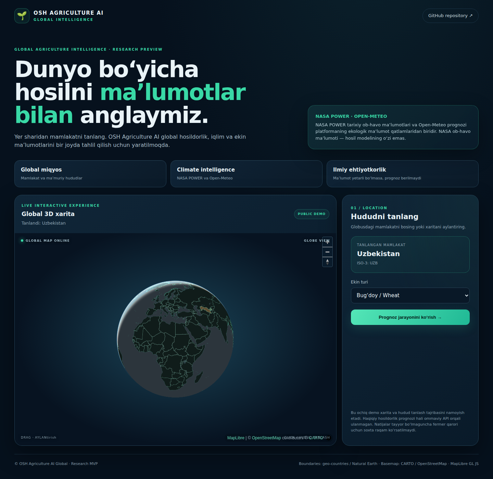

# Dunyo bo‘yicha hosil prognozi, NASA ma’lumotlari asosida

**OSH Agriculture AI Global** — global ma’muriy chegaralar, MAPSPAM fazoviy ekin qatlamlari, iqlim manbalari va tekshiriladigan AI research ssenariylarini birlashtiruvchi global agrar demo.

🌍 **[Global data dashboard’ni ochish](https://sherzoddd2002.github.io/osh-agriculture-ai-global/)** · [GitHub repository](https://github.com/Sherzoddd2002/osh-agriculture-ai-global) · [JSON data manifest](docs/data/catalog.json)



[Qisqa demo: 3D globus, data archive va model laboratoriyasi](docs/assets/demo-walkthrough.gif)

## Public demo data coverage · 2026-11-10

| Public layer | Coverage |
|---|---:|
| Global administrative boundaries | 245 country/territory codes · ADM1 + ADM2 catalogue |
| IFPRI MAPSPAM 2020 v2r2 reference | 153 countries · 46 crops · 228,620 administrative summaries in the reference archive |
| Uzbekistan public MAPSPAM package | 14 ADM1 · 199 ADM2 · 46 crops |
| CROPGRIDS v1.08 catalogue | 173 crop layers (catalogue only; not a prediction input) |

> **Scientific scope:** MAPSPAM 2020 is a single reference-year gridded estimate (~9.3 km at the equator), not a current-year observation, field measurement, or future forecast. The public Pages bundle currently includes the Uzbekistan MAPSPAM package; other-country reference summaries must be exported, reviewed, and published separately. Private database rows and user uploads are not included.
---|---:|---|
| FAOSTAT QCL | **610,299** | 1961–2024 · 202 mamlakat/hudud · 169 item kodi |
| IFPRI MAPSPAM 2020 v2r2 | **228,620** | 153 mamlakat · 46 ekin · ADM0/ADM1/ADM2 |
| **Jami** | **838,919** | Ikki alohida manbaning yozuvlari |

**Qo‘shimcha katalog:** CROPGRIDS v1.08 (2020) 173 ekin qatlamiga ega, lekin u markaziy reference bazaga import qilinmagan va yuqoridagi jami qatorlarga kiritilmagan.

> **Ilmiy aniqlik:** FAOSTAT QCL milliy darajadagi yillik statistika; tuman kuzatuvi emas. MAPSPAM 2020 — taxminan 9.3 km gridli bitta reference yil, joriy yil yoki dala o‘lchovi emas. NASA POWER tarixiy ob-havo feature manbasi; hosildorlik modelining o‘zi emas. Public dashboard markaziy PostgreSQL bazasining tekshirilgan inventarizatsiyasini ko‘rsatadi, lekin xom shaxsiy DB qatorlarini ommaga chiqarmaydi. NDVI, SMAP va SoilGrids connectorlari hali rejalashtirilgan. Bu — ommaviy loyiha vitrinasidir, fermer xo‘jaligi uchun ishlab turgan prognoz xizmati emas.

---

> **Deploy:** GitHub Pages source `GitHub Actions` qilib sozlangach, `main` branchga merge/push qilingan o‘zgarishlar saytni avtomatik yangilaydi. Deployment holati repository’ning **Actions** bo‘limida ko‘rinadi. Sayt manzili: https://sherzoddd2002.github.io/osh-agriculture-ai-global/ .

## Project overview

**A location-first agricultural data and yield-forecasting platform.** Users select a country and administrative area, upload historical crop observations, enrich the selected area with environmental datasets, run quality checks, and receive a clearly labelled yield estimate.

> **Public-site architecture:** the public dashboard is hosted entirely by GitHub Pages. GitHub Actions builds static ADM1/ADM2 boundary packages for up to 245 country/territory codes. The browser reads these files directly; it does not call Fly.io, FastAPI, or PostgreSQL. Selecting an administrative area retrieves Open-Meteo history/forecast, Sentinel-2 scene metadata, and MAPSPAM summaries when a matching public country package exists. A user's real historical yield CSV is processed locally in the browser by a Ridge + ERA5-Land research scenario and is never uploaded. Uzbekistan ADM1 wheat, potato and raw-cotton series can use official SIAT data; other area/crop combinations require matching observed yield history. This is not a validated universal global-yield service.

For Uzbek setup instructions, see [README_UZ.md](README_UZ.md).

To publish the licensed global MAPSPAM country/province/district summaries from the maintainer's local PostgreSQL archive, follow [Public global MAPSPAM package export](docs/PUBLIC_MAPSPAM_EXPORT.md). Only validated aggregate packages are committed; FAOSTAT rows and user data are not included.

## Architecture

- **Frontend:** vanilla HTML/CSS/JS + MapLibre GL JS.
- **Public frontend:** vanilla HTML/CSS/JavaScript + MapLibre GL JS, hosted on GitHub Pages.
- **Public boundaries:** static ADM1/ADM2 GeoJSON packages for 245 country/territory codes, generated and validated by GitHub Actions; 14 Uzbekistan provinces and 199 districts are specifically validated.
- **Browser-side analysis:** Open-Meteo weather retrieval, Copernicus Sentinel-2 scene discovery, local CSV parsing, Ridge model and expanding-window OOF benchmark.
- **Research backend:** FastAPI, SQLAlchemy, PostgreSQL/PostGIS and a background worker remain in the repository for optional local/private deployments; they are not part of the public Pages runtime.
- **Environmental source status:** Sentinel-2 scene discovery is connected but NDVI pixels are not computed; SMAP and SoilGrids zonal raster inputs are not yet integrated.
- **Public deployment:** GitHub Pages + GitHub Actions only. No Fly.io service or public database is required. Automatic Fly deployment has been removed.

## Optional: shared central Windows + PostgreSQL server

For one shared multi-user website backed by an existing PostgreSQL 17.11 host, see [docs/CENTRAL_WINDOWS_POSTGRES.md](docs/CENTRAL_WINDOWS_POSTGRES.md). The owner can install/start the central server with:

```powershell
npx osh-agriculture-ai-global server-install
npx osh-agriculture-ai-global server-status
```

This mode uses the dedicated osh_global_app role and osh_agriculture_global database on localhost:5433. The database port must not be exposed to the public internet. Publish only the web app on 127.0.0.1:8080 through a configured HTTPS tunnel. End users access the public website in a browser; they do not run the server installer.

The central host stores users' records in one PostgreSQL database with account-level ownership checks. The current Windows-host topology is a single point of failure; configure backups, monitoring, automatic startup, and security controls before unrestricted public signup.

## Recommended: one local installation per person

Each person can run the application on their own computer without Fly.io or a shared cloud database. The local CLI uses a private SQLite database and binds the web server to `127.0.0.1:8080`.

Requirements: Git, Node.js 20+, Python 3.11+, and internet access for the first install and external boundary/weather APIs. Docker and PostgreSQL are not required for this mode.

Windows PowerShell:

```powershell
git clone https://github.com/Sherzoddd2002/osh-agriculture-ai-global.git
cd osh-agriculture-ai-global
.\ops\local.ps1 install
```

Or run the CLI directly:

```powershell
node .\bin\cli.js install
```

The installer opens <http://127.0.0.1:8080>. Keep the terminal window open while the local web server is running. From the same repository folder, use `.\ops\local.ps1 start, status, stop, and update` to manage it. See [docs/LOCAL_PER_USER.md](docs/LOCAL_PER_USER.md).

Each computer has its own database and its own user data. Local instances do not synchronize with each other or with the maintainer's PostgreSQL database. The MAPSPAM rows imported into a developer's database are not included in a fresh local install; distributing those reference rows requires a separately versioned data bundle.

## Alternative: local Docker Compose stack

For developers who prefer PostgreSQL/PostGIS in Docker rather than the personal SQLite installer:

```bash
cp .env.example .env
# Replace JWT_SECRET with a long random secret.
docker compose up --build
```

Open <http://127.0.0.1:8080> and API docs at <http://127.0.0.1:8080/docs>. Compose binds the web app and optional database port to loopback only. The named database volume persists between restarts; `docker compose down -v` deletes it.

## Dataset format

```csv
year,yield_t_ha,area_ha,production_t
2015,4.12,12000,49440
2016,4.25,12100,51425
2017,3.98,11900,47362
```

- `yield_t_ha` is tonnes per hectare.
- `area_ha` and `production_t` are optional.
- Record whether area means sown or harvested area.
- One row per crop-year per location is accepted by this MVP.

## Prediction governance

The model endpoint is a local research scenario, not a validated global crop model. It uses expanding-window chronological validation and a Persistence benchmark. It refuses to predict if fewer than eight aligned observations/features exist. Future-season weather is unknown, so a future prediction uses a recent five-year observed seasonal weather normal and is explicitly labelled `CLIMATOLOGY_SCENARIO`.

Generated yields are never re-labelled as observed values. A global training opt-in is stored as consent only; a later review must check provenance, license, units, time coverage, duplicates, and quality before the dataset enters a shared training pool.

## GitHub source

Repository: <https://github.com/Sherzoddd2002/osh-agriculture-ai-global>

Clone the public source with `git clone https://github.com/Sherzoddd2002/osh-agriculture-ai-global.git`. Do not commit `.env`, private user datasets, raw satellite rasters, credentials, or private OSH evidence. See [README_UZ.md](README_UZ.md).

## Sources and licensing

- geoBoundaries `gbOpen`: verify and retain per-boundary license metadata and attribution.
- NASA POWER: daily point weather source; this MVP uses a representative point, not polygon-wide zonal statistics.
- Sentinel-2, SMAP, SoilGrids connectors must each declare units, source version, quality flags, temporal/spatial coverage, and licensing when implemented.

Application code is MIT; third-party data and map tiles retain their own licenses.
