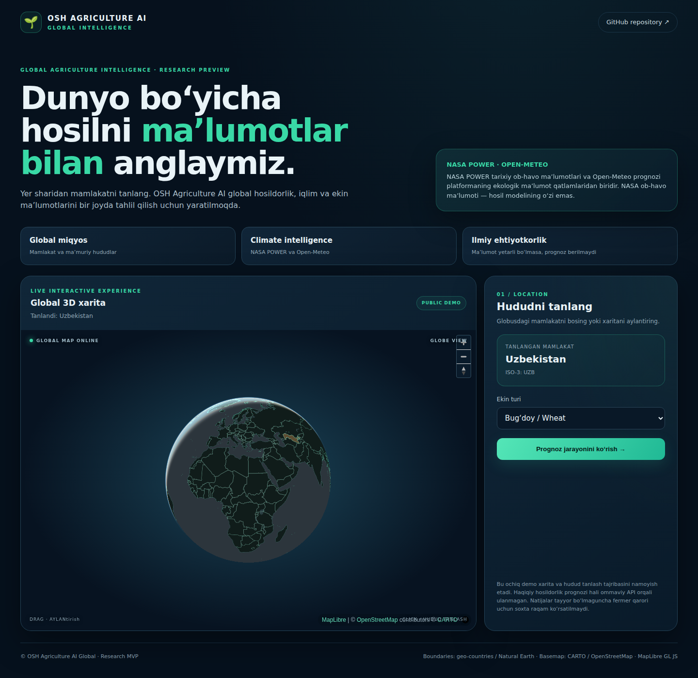

# Dunyo bo‘yicha hosil prognozi, NASA ma’lumotlari asosida

**OSH Agriculture AI Global** — FAOSTAT tarixiy statistikasi, MAPSPAM fazoviy ekin qatlamlari, iqlim manbalari va ML tahlilini birlashtiruvchi global agrar research platforma.

🌍 **[Global data dashboard’ni ochish](https://sherzoddd2002.github.io/osh-agriculture-ai-global/)** · [GitHub repository](https://github.com/Sherzoddd2002/osh-agriculture-ai-global) · [JSON data manifest](docs/data/catalog.json)



[Qisqa demo: 3D globus, data archive va model laboratoriyasi](docs/assets/demo-walkthrough.gif)

## Ma’lumotlar inventarizatsiyasi · 2026-11-08

| Arxiv | Bazadagi qatorlar | Qamrov |
|---|---:|---|
| FAOSTAT QCL | **610,299** | 1961–2024 · 202 mamlakat/hudud · 169 item kodi |
| IFPRI MAPSPAM 2020 v2r2 | **228,620** | 153 mamlakat · 46 ekin · ADM0/ADM1/ADM2 |
| **Jami** | **838,919** | Ikki alohida manbaning yozuvlari |

**Qo‘shimcha katalog:** CROPGRIDS v1.08 (2020) 173 ekin qatlamiga ega, lekin u markaziy reference bazaga import qilinmagan va yuqoridagi jami qatorlarga kiritilmagan.

> **Ilmiy aniqlik:** FAOSTAT QCL milliy darajadagi yillik statistika; tuman kuzatuvi emas. MAPSPAM 2020 — taxminan 9.3 km gridli bitta reference yil, joriy yil yoki dala o‘lchovi emas. NASA POWER tarixiy ob-havo feature manbasi; hosildorlik modelining o‘zi emas. Public dashboard markaziy PostgreSQL bazasining tekshirilgan inventarizatsiyasini ko‘rsatadi, lekin xom shaxsiy DB qatorlarini ommaga chiqarmaydi. Sentinel-2 STAC sahna qidiruvi ulangan, ammo NDVI raster hisoblanishi hali yo‘q. SMAP SPL3SMP_E v6 mahsuloti mavjud, lekin Earthdata Login va raster adapter kerak. SoilGrids REST API pausada; WCS/WebDAV orqali AOI raster adapteri hali yozilishi kerak.

---

> **Deploy:** GitHub Pages source `GitHub Actions` qilib sozlangach, `main` branchga merge/push qilingan o‘zgarishlar saytni avtomatik yangilaydi. Deployment holati repository’ning **Actions** bo‘limida ko‘rinadi. Sayt manzili: https://sherzoddd2002.github.io/osh-agriculture-ai-global/ .

## Ochiq demo va loyiha haqida

**Dunyo bo‘yicha hudud tanlash, qishloq xo‘jaligi ma’lumotlarini birlashtirish va hosildorlikni prognozlash platformasi.**

Bu yangi global loyiha. U sizning mavjud `E:\OSH`, `osh` PostgreSQL bazangiz yoki O‘zbekiston uchun tayyorlangan eski CSV fayllaringizni o‘zgartirmaydi.

## Hozirgi relizda nima ishlaydi?

- Dunyo mamlakatlari uchun geoBoundaries API orqali ADM0–ADM5 ma’muriy chegaralarini qidirish.
- Xarita ustida Polygon/MultiPolygon hududini tanlash va PostGIS’ga saqlash.
- Hisob yaratish va kirish; yuklangan dataset foydalanuvchi hisobiga bog‘lanadi.
- CSV orqali tarixiy hosildorlik qatorlarini yuklash, yil/ustun/ekin mavsumi formatini tekshirish.
- NASA POWER daily API orqali tanlangan hududning vakillik nuqtasi uchun 2010-yildan boshlab yillik iqlim tarixini olish va SQL’ga yozish.
- Open-Meteo orqali joriy ob-havo hamda 16 kungacha qisqa muddatli prognozni olish va SQL’da saqlash.
- Hudud saqlanishi bilan, hosildorlik CSV bo‘lmasa ham, iqlim tahlili avtomatik navbatga tushadi.
- Ob-havoni foydalanuvchi ko‘rsatgan mavsum va hosil yili bilan birlashtirish.
- Background worker orqali uzoq davom etadigan ishlarni web so‘rovlaridan ajratish.
- Hosildorlik CSV yuklanganda ob-havo job’i avtomatik boshlanadi; kamida 8 ta moslangan haqiqiy hosil kuzatuvi va kamida 2 ta usable ob-havo feature bo‘lsa, Linear, Ridge, ElasticNet, Random Forest, Extra Trees va HistGradientBoosting modellarini expanding validation bilan baholaydi va Persistence benchmark bilan solishtiradi.
- Yetarli hosildorlik ma’lumoti bo‘lmasa, model prognozi yasamaydi; mavjud iqlim tarixi, joriy ob-havo va qisqa muddatli prognozni ko‘rsatadi.

## Public demo: kichik hudud va maydon tahlili

[Dashboard’ni oching](https://sherzoddd2002.github.io/osh-agriculture-ai-global/) → **Maydon tahlili** bo‘limiga o‘ting.

- Mamlakat ISO-3 (masalan, UZB) va ADM1–ADM5 darajasini tanlab, geoBoundaries poligonlarini xaritada ko‘rsatish mumkin.
- **Maydon chizish** tugmasi bilan xaritada kamida 3 nuqta bosib custom dala poligoni yarating; **Poligonni tugatish** bilan yakunlang.
- **Hududni tahlil qilish** Open-Meteo ERA5-Land tarixiy reanalysis qatori va 7 kunlik ob-havo prognozini tanlangan poligon markazidan oladi. Bu butun poligon bo‘yicha zonal o‘rtacha emas.
- Copernicus STAC orqali oxirgi 12 oydagi Sentinel-2 L2A sahnalari (bulutlilik ≤30%) qidiriladi. Natija scene metadata; NDVI hali hisoblanmaydi.
- Haqiqiy `year,yield_t_ha` CSV faylni brauzerda tanlab, Ridge ML + expanding-window OOF / Persistence benchmark hisoblash mumkin. Har bir yield mavsumi Open-Meteo ERA5-Land harorat, yog‘in, ET₀ va GDD feature’lari bilan moslanadi; kamida 8 ta yetarli qamrovli yil talab qilinadi. Kelajak ob-havosi so‘nggi 5 mavsum normasi bilan taxmin qilinadi. CSV serverga yuklanmaydi. Bu bitta AOI uchun research scenario, global tasdiqlangan model emas.

**Public demo cheklovi:** GitHub Pages statik sayt. U autentifikatsiyalangan FastAPI, PostgreSQL, shaxsiy datasetlar yoki background worker bilan bog‘lanmagan; sahifadagi maydon chizmasi saqlanmaydi. Doimiy AOI, full ML pipeline va markaziy FAOSTAT/MAPSPAM qatorlari uchun haqiqiy backend + DB + worker HTTPS orqali alohida deploy qilinishi kerak.

## Environmental connectorlar holati

- **Sentinel-2:** Copernicus STAC scene discovery ishlaydi. B04/B08 raster olish, SCL/CLD cloud-shadow mask, NDVI va mavsumiy zonal statistikalar hali bajarilmagan.
- **NASA SMAP:** SPL3SMP_E v6 daily 9 km mahsuloti mavjud; download uchun bepul NASA Earthdata Login, quality flag filtri va raster zonal adapter kerak. 9 km signal dala o‘lchovi emas.
- **SoilGrids:** 250 m global tuproq xaritalari va noaniqlik qatlamlari mavjud. ISRIC REST API pausada; WCS GetCoverage/WebDAV VRT orqali AOI subset va zonal-statistika adapteri hali kerak.

Texnik endpointlar, aniqlik va keyingi processing bosqichlari: [docs/ENVIRONMENT_CONNECTORS.md](docs/ENVIRONMENT_CONNECTORS.md).

## Ixtiyoriy: markaziy server — barcha foydalanuvchilar uchun bitta PostgreSQL

Agar barcha odamlarning ma’lumotlari sizning PostgreSQL serveringizga saqlanishi kerak bo‘lsa, lokal SQLite installer emas, markaziy server rejimini ishlating.

**Faqat PostgreSQL 17.11 ishlayotgan sizning Windows kompyuteringizda** (npm paketi e’lon qilingandan keyin):

```powershell
npx osh-agriculture-ai-global server-install
npx osh-agriculture-ai-global server-status
```

Bu rejim:
- mavjud `osh_agriculture_global` bazasiga `osh_global_app` roli orqali ulanadi;
- FastAPI web-server va background worker’ni ishga tushiradi;
- har bir akkauntning hududlari, datasetlari va job natijalarini markaziy PostgreSQL’ga saqlaydi;
- foydalanuvchilar orasida shaxsiy ma’lumotlarni account ownership orqali ajratadi.

Server boshqaruvi:

```powershell
npx osh-agriculture-ai-global server-start
npx osh-agriculture-ai-global server-status
npx osh-agriculture-ai-global server-stop
npx osh-agriculture-ai-global server-update
```

End users uchun bu buyruqlar kerak emas. Ular siz e’lon qilgan HTTPS sayt manziliga brauzerdan kiradi.

**Internetga chiqarish:** Cloudflare Tunnel orqali faqat `http://127.0.0.1:8080` ni e’lon qiling. PostgreSQL `5433` portini internetga ochmang. Vaqtinchalik Quick Tunnel faqat sinov uchun; doimiy domenli tunnel kerak. Batafsil: [docs/CENTRAL_WINDOWS_POSTGRES.md](docs/CENTRAL_WINDOWS_POSTGRES.md).

**Muhim:** barcha foydalanuvchilarning bazasi bitta bo‘lsa-da, hozirgi model tahlili har bir foydalanuvchining o‘z hosildorlik datasetida bajariladi. Boshqa foydalanuvchilar ma’lumotini global modelga qo‘shish rozilik, litsenziya va sifat tekshiruvi bilan alohida boshqarilishi kerak.

## Har bir foydalanuvchi o‘z kompyuterida (tavsiya etiladi)

Bu rejimda har bir odam dasturni GitHub'dan olib, o‘z kompyuterida ishga tushiradi. Fly.io, markaziy server, PostgreSQL yoki Docker shart emas.

**Talablar:** Node.js 20+, Python 3.11+ va birinchi o‘rnatish hamda tashqi ob-havo/chegara API'lari uchun internet.

Windows PowerShell:

```powershell
git clone https://github.com/Sherzoddd2002/osh-agriculture-ai-global.git
cd osh-agriculture-ai-global
.\ops\local.ps1 install
```

Yoki CLI'ni bevosita ishga tushiring:

```powershell
node .\bin\cli.js install
```

O‘rnatish tugagach brauzerda <http://127.0.0.1:8080> ochiladi. Web-server ishlayotgan paytda terminal oynasini yopmang.

Boshqarish:

```powershell
.\ops\local.ps1 start
.\ops\local.ps1 status
.\ops\local.ps1 stop
.\ops\local.ps1 update
```

CLI ma’lumotlarni foydalanuvchining o‘z kompyuterida saqlaydi:

- Windows: `%LOCALAPPDATA%\OSH\AgricultureAI\data\agriculture.sqlite3`
- macOS: `~/Library/Application Support/OSH/AgricultureAI/data/agriculture.sqlite3`
- Linux: `~/.local/share/osh-agriculture-ai-global/data/agriculture.sqlite3`

Har bir kompyuterning bazasi alohida. Bir odam yuklagan CSV yoki tahlil natijasi boshqa odamning kompyuteriga avtomatik o‘tmaydi. Server faqat `127.0.0.1` ga bog‘langan: boshqa kompyuterlardan unga kirib bo‘lmaydi.

**MAPSPAM bo‘yicha muhim eslatma:** ishlab chiquvchining PostgreSQL bazasiga import qilingan ADM0–ADM1 (109 112 qator) yangi lokal o‘rnatishga avtomatik ko‘chmaydi. Hozircha lokal o‘rnatish bo‘sh MAPSPAM jadvali yaratadi. MAPSPAM natijalarini barcha foydalanuvchilarga tarqatish uchun alohida, versiyalangan ma’lumotlar paketi va import buyrug‘i kerak bo‘ladi. GeoBoundaries, NASA POWER va Open-Meteo kabi tashqi manbalar esa internet orqali ishlaydi.

Boshqa odamlar bilan bitta umumiy ma’lumotlar bazasidan foydalanish kerak bo‘lsa, quyidagi markaziy server rejimini tanlang.

## CSV formati

```csv
year,yield_t_ha,area_ha,production_t
2015,4.12,12000,49440
2016,4.25,12100,51425
2017,3.98,11900,47362
```

`yield_t_ha` — t/ha bo‘lishi kerak. `area_ha` ustuni ixtiyoriy; uning ekilgan maydon yoki yig‘ib olingan maydon ekanini tanlash kerak. Har bir dataset ichida bitta hosil yiliga bitta qator qabul qilinadi.

## Ma’lumotlarni qayta ishlash ketma-ketligi

1. Hisob yarating yoki tizimga kiring.
2. Mamlakat ISO-3 kodini (masalan, `UZB`, `KAZ`, `DEU`) va ma’muriy darajani tanlang.
3. Chegaralarni yuklang va xaritada kerakli hududni bosing.
4. Hududni saqlang.
5. Hosildorlik CSV faylini va ustunlarini belgilang, ekin mavsumining boshlanish/tugash sanasini kiriting.
6. Datasetni yuklang. U SQL bazaga yoziladi va ob-havo bilan birlashtirish job’i avtomatik navbatga tushadi.
7. Job tugagach, qamrov va avtomatik model tahlilini ko‘ring. Yetarli tarix bo‘lmasa, model ishlatilmaydi va sabab ko‘rsatiladi.

## Juda muhim ilmiy cheklovlar

- NASA POWER bu MVP’da poligonning vakillik nuqtasidan olinadi; bu butun poligon maydoni bo‘yicha o‘rtacha ob-havo qiymati emas.
- NDVI, SMAP, SoilGrids hali amalda yig‘ilmaydi.
- Kelajak hosil yili uchun haqiqiy ob-havo hali mavjud bo‘lmasligi mumkin. Shunda model oxirgi 5 yillik mavsumiy ob-havo o‘rtachasidan scenario yaratadi va buni alohida belgilaydi.
- Bu bitta datasetga moslangan tadqiqot prognozi; global tasdiqlangan model emas.
- AI yaratgan hindcast/forecast qiymatlari kuzatilgan haqiqiy hosildorlik sifatida global modelga qayta berilmaydi.
- Global treningga qo‘shish roziligi alohida. Rozilikning o‘zi datasetni avtomatik tasdiqlamaydi; avval litsenziya, birlik, manba, vaqt qamrovi va sifat nazorati kerak.

## GitHub manbasi

Loyihaning rasmiy public repository manzili: <https://github.com/Sherzoddd2002/osh-agriculture-ai-global>.

Yangi foydalanuvchilar yuqoridagi `git clone` buyrug‘i bilan kodni oladi. Mavjud clone'ni yangilash uchun:

```powershell
git pull --ff-only origin main
```

`.env`, foydalanuvchilarning CSV fayllari, maxfiy API keylar, SQLite bazalari va katta rastrlar GitHub’ga joylanmasligi kerak. Ular `.gitignore` bilan chiqarib tashlangan bo‘lsa ham, commit qilishdan oldin tekshiring.

## Fly.io

Fly’da web va worker alohida process group bo‘lib ishlaydi. `fly.toml` web uchun autostop’ni o‘chiradi. Alohida managed PostgreSQL cluster yaratib, PostGIS yoqiladi; `DATABASE_URL` va `JWT_SECRET` secrets sifatida qo‘shiladi. Batafsil qadamlar `docs/FLY_DEPLOY.md` va `README.md` ichida.

**Doimiy ishlash xarajatsiz degani emas.** Fly Machines, Managed Postgres, storage va trafik pullik bo‘lishi mumkin. Avval kichik test muhiti va xarajat ogohlantirishlarini sozlang. Bitta server nol downtime kafolati emas.
